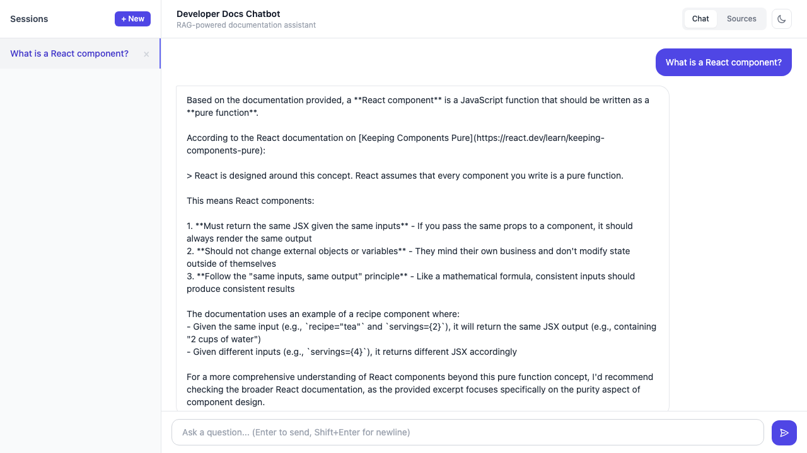

# Developer Docs Chatbot

A RAG-powered chatbot for developer documentation. Index any documentation site by URL and ask questions about it in natural language — with streaming responses, persistent chat history, and source citations.



## Features

- **SSE streaming** — real-time token-by-token response rendering via Server-Sent Events
- **Multi-turn conversations** — persistent session history with full context carry-over
- **Source citations** — every answer links back to the exact documentation page it used
- **Dark mode** — full dark/light theme support
- **Web scraper + chunker** — index any documentation site by URL, auto-chunked with overlap
- **pgvector semantic search** — cosine similarity retrieval over nomic-embed-text embeddings
- **SSRF protection** — internal network URLs blocked at ingestion time
- **X-Api-Key auth** — API key authentication on all endpoints
- **156 tests** — 99% frontend coverage (Vitest) + full backend suite (Pytest)

## Stack

| Layer | Technology |
|---|---|
| Backend | Python 3.12 + FastAPI |
| LLM | Claude Haiku 4.5 (Anthropic SDK, SSE streaming) |
| Embeddings | Ollama (nomic-embed-text, local) |
| Database | PostgreSQL 16 + pgvector |
| Frontend | Vite + React + TypeScript + TailwindCSS |
| Containerization | Docker + Docker Compose |
| Testing | Pytest (backend) + Vitest (frontend) |

## Prerequisites

- Docker + Docker Compose
- Ollama installed and running locally (`ollama pull nomic-embed-text`)
- Anthropic API key

## Quick Start

```bash
# 1. Environment variables
cp .env.example .env
# Edit: ANTHROPIC_API_KEY=...

# 2. Start services
docker compose up -d

# 3. Run database migrations
docker compose exec api python -m app.db.migrate

# 4. Frontend dev server (development only)
cd frontend && npm install && npm run dev
```

API: http://localhost:8000  
Frontend: http://localhost:5173 (dev) / http://localhost:3000 (prod)  
API docs: http://localhost:8000/docs

## Indexing Documentation

```bash
curl -X POST http://localhost:8000/api/sources \
  -H "Content-Type: application/json" \
  -d '{"name": "Tailwind CSS", "base_url": "https://tailwindcss.com/docs"}'
```

## Project Structure

```
developer-docs-chatbot/
├── README.md
├── DEVELOPMENT_SPEC.md      # Full specification and development plan
├── docker-compose.yml
├── .env.example
├── backend/
│   ├── Dockerfile
│   ├── pyproject.toml
│   └── app/
│       ├── api/             # FastAPI route handlers
│       ├── services/        # Business logic (ingestion, retrieval, chat)
│       ├── db/              # Database connection + migrations
│       ├── models/          # Pydantic schemas
│       └── config.py        # Pydantic-settings configuration
├── frontend/
│   ├── Dockerfile
│   └── src/
│       ├── components/      # React components
│       ├── hooks/           # Custom hooks (useChat, useSources, useSSE)
│       ├── api/             # API client functions
│       └── types/           # TypeScript types
└── docs/
    └── architecture.md
```

## Development Phases

See [DEVELOPMENT_SPEC.md](DEVELOPMENT_SPEC.md) for full details.

1. **Infrastructure** — Docker, FastAPI skeleton, DB schema
2. **Document ingestion** — web scraper, chunking, embeddings
3. **RAG core** — pgvector search, Claude integration
4. **Chat history** — session management, multi-turn conversation
5. **SSE streaming** — real-time token display
6. **Frontend** — chat UI, source management
7. **Code quality** — tests, lint, mypy, review

## AI Engineering Learning Path

This project is the **6th phase** of the AI Engineering learning path.

| Phase | Project | Status |
|---|---|---|
| 1 | Claude API basics | Done |
| 2 | Prompt engineering | Done |
| 3 | RAG pipeline | Done |
| 4 | FastAPI + pgvector RAG demo | Done |
| 5 | LLM evaluation (RAGAS) | Done |
| 6 | **Developer Docs Chatbot** | **Done** |
